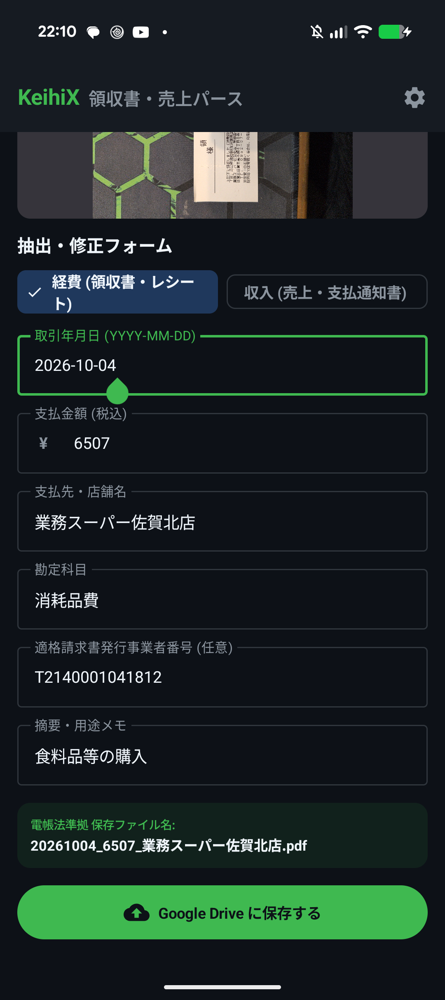

# 【KeihiX開発日記#4】Google Driveを自作DBにする。drive.fileスコープとCSV追記（Read-Modify-Write）の実装ログ

個人開発者や副業エンジニアが直面する確定申告の壁。
「領収書の整理が面倒」「でも月額課金のクラウド会計ソフトを入れるほど取引件数は多くない」という課題を解決するため、サーバー代0円・個人情報保持ゼロのAndroidアプリ **「KeihiX」** を自作しています。

* **第1回:** 【構想・設計編】月額課金したくない個人開発者が、サーバー代0円・個人情報保持ゼロの「レシート＆収入管理アプリ」を設計した話
* **第2回:** 【電帳法＆免責編】高価なタイムスタンプは不要？個人事業主が電帳法を合法ハックする事務処理規程とCLI実機開発
* **第3回:** 【AI抽出・BYOK編】Geminiで領収書＆売上明細をパースする。Structured OutputsとBYOKの実装ログ（実測3.0秒）

前回（#3）は、Gemini 1.5 Flash を用いて画像やPDFから確定申告・電帳法に必要なメタデータを構造化抽出（AIパース）するロジックを実装しました。

第4回となる今回は、抽出・確認したデータを **「ユーザー自身の Google Drive をクラウドストレージおよび自作データベースとして直接活用し、サーバーレスで保存・台帳化する機能」** の設計と実装ログをまとめます。

---

## 1. なぜ自前のDBサーバーを持たず、Google Drive をDB代わりにするのか？

一般的なWebアプリやスマートフォンアプリでは、バックエンドにデータベース（PostgreSQL、Firestore、Supabase等）を構築し、そこにユーザーデータやファイルURLを保存するのが定石です。

しかし、個人開発・副業ツールとして「KeihiX」を設計するにあたり、自前バックエンドの採用には以下の大きなリスクとコストが存在しました。

* **固定インフラ費用の発生:**
  たとえユーザーが利用していない月であっても、DBサーバーやバックエンドの中継サーバーを維持するための費用が発生します。
* **機密データ・領収書ファイルの漏洩責任:**
  領収書や売上明細には、取引先の名称、購入品目、銀行口座情報、住所などの機密情報が含まれます。これらを開発者側のサーバーで一元管理することは、セキュリティ監視や暗号化運用において個人開発者が負うべきリスクを超過します。

そこで KeihiX では、 **「ユーザー自身が所有する Google Drive」** をそのままストレージ兼データベースとして活用するアーキテクチャを採用しました。

```text
[保存先: ユーザー自身の Google Drive]
  └── 確定申告_2026/
        ├── receipts/           (経費の画像・PDF)
        ├── incomes/            (収入の支払明細・請求書控えPDF)
        └── transaction_log.csv (統合トランザクション台帳)
```

この構成により、開発者側のインフラ維持費は **完全0円** となり、ファイルや仕訳データはすべてユーザー自身の管理領域内でのみ完結します。

---

## 2. セキュリティ境界を作る `drive.file` スコープの選定

Androidから Google Drive API を利用する際、最も重要なのが **認可スコープ（OAuth 2.0 Scope）** の選定です。

Google Drive API には複数のスコープが存在しますが、KeihiXでは最小権限原則に基づき **`https://www.googleapis.com/auth/drive.file`** を採用しています。

### なぜフル権限（`drive`）を避けたのか？
* **`https://www.googleapis.com/auth/drive`（フルアクセス）:**
  Googleアカウント連携時の同意画面において、「Google ドライブ内のすべてのファイルの表示、編集、作成、削除」という強い警告メッセージが表示されます。アプリがユーザーのプライベートな写真や私的ドキュメントまで参照できる状態になるため、たとえオープンソースであっても心理的抵抗が極めて高くなります。
* **`https://www.googleapis.com/auth/drive.file`（本アプリ作成ファイルのみ）:**
  「KeihiX が作成したファイル・フォルダのみ」に操作範囲が限定されます。ユーザーが既存で持っている他のファイルや写真には一切アクセスできません。

### 【設計上の落とし穴】アプリ再インストール時の権限境界
ただし、この `drive.file` スコープには運用上のトレードオフ（弱点）が存在します。

* **再インストール時のアクセス遮断リスク:**
  `drive.file` で付与されるアクセス権は、クライアントIDとアプリの署名情報に強く紐づいています。ユーザーが端末を変更したり、アプリをアンインストール・再インストールした場合、同じ Google アカウントであっても過去に作成した `確定申告_2026` フォルダが「他者が作成したファイル」と判定され、再利用できなくなるケースがあります。
* **KeihiXでの割り切りと対策:**
  本アプリでは、フォルダ探索時に既存フォルダが見つからない場合は同名で新規作成を許可する設計としています。また、過去年度のデータについてはユーザー自身が Google Drive 上で直接閲覧・管理できるため、アプリ側の永続化境界を無理に広げず、セキュリティの安全性を最優先しました。

### 【認証設計のリアル】Gemini の BYOK（APIキー）と Google Drive（OAuth）の違い
本アプリでは、Gemini API についてはユーザー自身が取得したキーを入力してもらう **BYOK（Bring Your Own Key）** を採用しています。
そのため、「Google Drive の認証もユーザー自身のキーでやってもらえば、開発者側で何も設定しなくてよいのでは？」という疑問が生じます。

しかし、ここには **「API キー認証」と「OAuth 2.0（三者間認可）」の根本的な設計の違い** があります。

* **Gemini（API キー方式）:**
  単なる文字列トークンであるため、ユーザーが AI Studio で発行したキーをアプリに貼り付けるだけで、ユーザー個人のクォータ・課金境界として完結します。
* **Google Drive（OAuth 2.0 方式）:**
  ユーザーの私的ファイルを守るため、アプリが Google のサーバーへ接続する際に **「アプリ自体の身元証明（パッケージ名 ＋ 署名 SHA-1）」** を Google 側から提示するよう求められます。
  ユーザー全員に「Google Cloud Console でプロジェクトを作って OAuth クライアントを発行してね」と強いるのは一般向けアプリとして不可能なため、アプリ側の身元（名刺）は開発者が用意し、ユーザーはログイン画面で「許可」を押すだけの UX にする必要があります。

ここで重要になるのが、開発者の身元を使って不特定多数のユーザーに公開するための **「Google OAuth 同意画面の審査」** です。
もしフル権限（`drive`）を要求していた場合、第三者機関による有償のセキュリティ監査（CASA 監査、費用数十万円〜）が必須になりますが、KeihiX が選定した **`drive.file` は制限付きスコープではないため、無償のドキュメント審査のみで一般公開（人数無制限）へ移行可能** です。セキュリティと個人開発の持続可能性の両面で、このスコープ選定が決定打となりました。

---

## 3. Google Drive REST API に「Append（行追加）API」が存在しない壁

Google Drive 上の `transaction_log.csv` を自作データベースとして運用するにあたり、最大の技術的ハードルとなったのが **「Google Drive REST API にファイル末尾への追記（Append）エンドポイントが存在しない」** という仕様です。

### Read-Modify-Write パターンの採用
通常のファイルシステムであれば行の追加書き込み（Append）が可能ですが、Google Drive API v3 ではファイル更新は常にストリーム全体の再アップロード（Update）を要求されます。

そのため、CSV への1行追加であっても以下の **Read-Modify-Write** の手順を踏む必要があります。

1. ルートフォルダ内の `transaction_log.csv` を検索。
2. **ファイルが存在しない場合（1件目の保存時）:**
   初期ヘッダー（列名）と1件目のデータを結合したバイト列を生成し、新規ファイルとして Drive にアップロード。
3. **ファイルが既に存在する場合:**
   Drive 上の既存 CSV ファイルを全件ダウンロードし、末尾に新規行（改行コードをサニタイズした文字列）を追加。その後、`Drive.Files.Update` を呼び出してファイル全体を上書き更新。

```text
[新規保存時]
  1. transaction_log.csv をダウンロード (Read)
  2. メモリ上で末尾に新規仕訳行を結合 (Modify)
  3. Google Drive 上のファイルを上書き保存 (Write)
```

### レースコンディション（競合破壊）のリスクと現実的な評価
複数クライアントから秒単位で同時に書き込みが発生する分散システムでは、この Read-Modify-Write はデータの消失（ロストアップデート）を引き起こす致命的な設計になります。

しかし、本アプリの利用形態は **「個人開発者・副業エンジニアが、スマートフォンから手作業で1件ずつ領収書を確認して保存する（月数件〜数十件規模）」** です。
単一端末からの逐次的な操作であれば、このシンプルな Read-Modify-Write 方式で十分に安定動作します。

同時押しによる多重実行を防ぐため、UI側で保存処理中のボタンを無効化（ローディング化）し、将来のオフライン耐性や通信断リトライについては WorkManager によるローカルキューイングで担保する方針を取りました。

---

## 4. 地味に重要な「Windows Excel で文字化けしない UTF-8 BOM」の付与

出力される `transaction_log.csv` は、年末の確定申告（国税庁「確定申告書等作成コーナー」）で収支内訳書や青色申告決算書へ転記するためのマスターデータになります。

日本の個人開発者や副業の実務環境では、この CSV を Windows の Microsoft Excel で直接開いて検算・集計するケースが非常に多く見られます。

一般的な UTF-8（BOMなし）で CSV を出力すると、Excel でダブルクリックして開いた際に「取引先名」や「勘定科目」などの日本語が文字化けしてしまいます。
これを防止するため、初期ファイル生成時および追記時のバイト列の先頭に **UTF-8 BOM（Byte Order Mark: `0xEF, 0xBB, 0xBF`）** を明示的に付与する処理を組み込みました。

```kotlin
class CsvTransactionRecorder {
    // UTF-8 BOM: Windows Excel での日本語文字化けを防止
    val utf8Bom: ByteArray = byteArrayOf(0xEF.toByte(), 0xBB.toByte(), 0xBF.toByte())

    fun createInitialCsvBytes(firstTransaction: ParsedTransaction? = null, drivePath: String = ""): ByteArray {
        val sb = StringBuilder()
        sb.append(ParsedTransaction.CSV_HEADER).append("\r\n")
        if (firstTransaction != null) {
            sb.append(firstTransaction.toCsvRow(drivePath)).append("\r\n")
        }
        val textBytes = sb.toString().toByteArray(StandardCharsets.UTF_8)
        return utf8Bom + textBytes
    }
}
```

---

## 5. 実装コードの構成とポイント

今回の実装では、主に以下の4つのモジュールを実装しました。

* **`GoogleAuthManager.kt`:**
  `GoogleAccountCredential.usingOAuth2` をラップし、`drive.file` スコープでのアカウント選択 Intent の生成、および認可済み `Drive` サービスのオンデマンド提供を担当。
* **`DriveStorageRepository.kt` (`GoogleDriveStorageRepository`):**
  ルートフォルダ `確定申告_{年}`、サブフォルダ `receipts/`、`incomes/` の探索・作成と、セッション中のフォルダIDキャッシュ。
  電帳法検索3要件に準拠したファイル名（`{YYYYMMDD}_{金額}_{取引先}.{拡張子}`）によるアップロード。
* **`CsvTransactionRecorder.kt`:**
  BOM付きヘッダーの生成、改行コード（`\r\n`）の補正、既存 CSV バイト列への安全な行追記。
* **UI 連携 (`SettingsScreen.kt`, `ExtractionScreen.kt`):**
  設定画面でのアカウント連携状態表示・連携解除ボタン、および抽出画面からの非同期保存ボタンと成否フィードバック表示。

```kotlin
// GoogleDriveStorageRepository.kt: 保存フローの骨格
override suspend fun saveTransaction(
    year: Int,
    transaction: ParsedTransaction,
    fileBytes: ByteArray,
    mimeType: String,
    extension: String
): DriveSaveResult = withContext(Dispatchers.IO) {
    val drive = driveServiceProvider() ?: return@withContext DriveSaveResult.Error("Google Drive 未連携")

    try {
        // 1. フォルダ構成の自動解決（メモリキャッシュ利用）
        val hierarchy = ensureFolderHierarchy(year).getOrThrow()

        // 2. 領収書 / 明細ファイルのアップロード
        val targetFolderId = if (transaction.type == TransactionType.EXPENSE) hierarchy.receiptsFolderId else hierarchy.incomesFolderId
        val subDir = if (transaction.type == TransactionType.EXPENSE) "receipts" else "incomes"
        val fileName = "${transaction.toCompliantFileName()}.$extension"
        val relativePath = "$subDir/$fileName"

        val fileMetadata = File().apply {
            name = fileName
            parents = listOf(targetFolderId)
        }
        val mediaContent = ByteArrayContent(mimeType, fileBytes)
        val uploadedFile = drive.files().create(fileMetadata, mediaContent).execute()

        // 3. transaction_log.csv への Read-Modify-Write 追記
        updateCsvLog(drive, hierarchy.rootFolderId, hierarchy.csvFileId, transaction, relativePath)

        DriveSaveResult.Success(uploadedFile.id, relativePath, true, transaction)
    } catch (e: Exception) {
        DriveSaveResult.Error("保存失敗: ${e.localizedMessage}", e)
    }
}
```

### 実機でのUI連携と電帳法ファイル名プレビュー
抽出画面（`ExtractionScreen`）では、端末カメラでの直接撮影や画像選択により Gemini によるパースが完了すると、下部に電帳法の検索3要件（日付_金額_取引先）を満たした保存ファイル名がリアルタイムでプレビューされます。

ユーザーは内容を確認・微修正した上で、最下部の **「Google Drive に保存する」** ボタンを 1 タップするだけで、裏側の Read-Modify-Write とファイルアップロードを実行できます。


*▲ 実機での動作確認画面。撮影した領収書から Gemini 3.1 Flash-Lite が「日付・金額・店舗名・科目・インボイス番号」を即座に抽出し、最下部に電帳法準拠のファイル名プレビュー（`20261004_6507_業務スーパー佐賀北店.pdf`）と Google Drive 保存ボタンが表示されている様子*

---

## 6. 技術的トレードオフのまとめ

今回の「Google Drive 直結 × 自作DB」構成におけるメリットとトレードオフ（割り切り）を整理します。

### メリット
* **完全な維持費ゼロ:**
  ユーザー自身のストレージ（無料枠15GB）を利用するため、開発者側にサーバー費用やDBホスティング費用が一切かからない。
* **情報漏洩責任の排除:**
  領収書画像・金額・取引先名が開発者のサーバーを通過せず、エンドツーエンドでユーザーの Drive に格納される。
* **電帳法・確定申告との親和性:**
  電帳法で求められる「日付・金額・取引先」による検索要件を、Drive のファイル名と CSV 台帳の双方で満たすことができる。

### 割り切った点・今後の課題
* **オフライン時の保存失敗:**
  通信環境がない場所で「保存」を押した場合にエラーとなるため、Phase 5 で WorkManager によるローカル一時保存とバックグラウンドリトライを導入予定。
* **CSV の肥大化と帯域消費:**
  Read-Modify-Write の特性上、年間の仕訳件数が増えるほどダウンロード・アップロードのデータ量が増加します。ただし、副業規模（年間数百件程度）であれば CSV ファイルサイズは数十〜数百KB程度に収まるため、実用上の帯域消費は問題にならない範囲と判断しました。

---

## まとめと今回のPR

今回は、Gemini で抽出したデータをユーザー自身の Google Drive へ直接保存し、電帳法・確定申告に対応した台帳（`transaction_log.csv`）へ追記する **「Google Drive 直結・サーバーレスストレージ基盤」** を実装しました。

* **今回作成した PR (#2) はこちら:** [PR #2: feat(drive): Google Drive REST API と drive.file スコープによるストレージ＆CSV追記基盤の実装](https://github.com/tryxlab/keihix/pull/2)

次回（#5）は、裏側の基盤設計からいよいよ「表舞台の使い勝手」へ舵を切り、日々の入力を最速化する **「スマホ実機でのUI/UX磨き込みと共有インテント（Share Target）対応」** に進む予定です。

---

### 【免責事項】
* 本記事および本アプリは、税理士法に基づく税務相談や税務申告書類の作成を行うものではありません。
* 電子帳簿保存法への適合や確定申告における勘定科目の最終判断については、所轄の税務署または税理士へご相談の上、ご自身の責任においてご判断ください。
* 記事内で紹介したアーキテクチャやコードの利用により生じたいかなる損害についても、筆者は責任を負いかねます。
