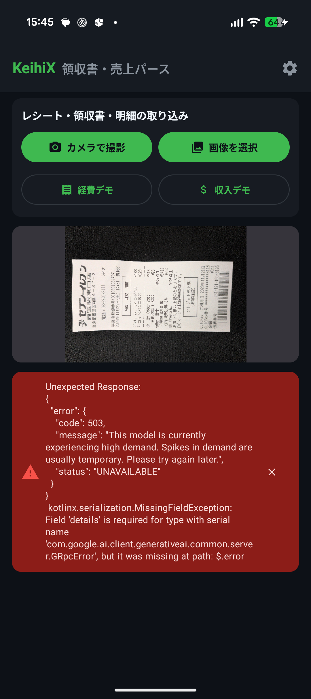
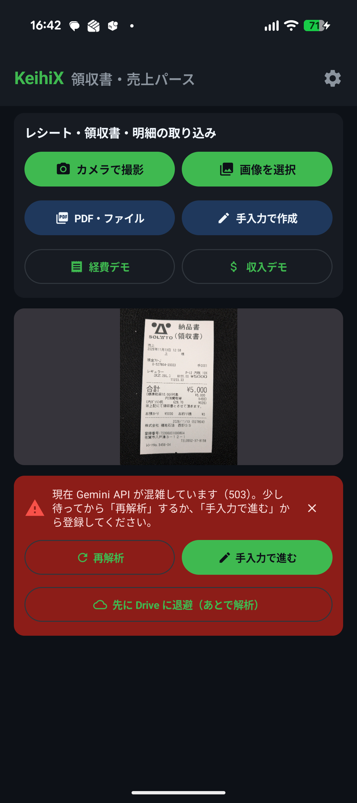

# 【KeihiX開発日記#5】実機の503エラー・OAuth同意・重複保存の罠を越えて。共有インテントとWorkManager、「あとで解析」のUX実装ログ

個人開発者や副業エンジニアが直面する確定申告の壁。
「領収書の整理が面倒」「でも月額課金のクラウド会計ソフトを入れるほど取引件数は多くない」という課題を解決するため、サーバー代0円・個人情報保持ゼロのAndroidアプリ **「KeihiX」** を自作しています。

* **第1回:** 【構想・設計編】月額課金したくない個人開発者が、サーバー代0円・個人情報保持ゼロの「レシート＆収入管理アプリ」を設計した話
* **第2回:** 【電帳法＆免責編】高価なタイムスタンプは不要？個人事業主が電帳法を合法ハックする事務処理規程とCLI実機開発
* **第3回:** 【AI抽出・BYOK編】Geminiで領収書＆売上明細をパースする。Structured OutputsとBYOKの実装ログ（実測3.0秒）
* **第4回:** 【Google Drive直結編】Google Driveを自作DBにする。drive.fileスコープとCSV追記（Read-Modify-Write）の実装ログ

前回（#4）は、Google Drive REST API（ `drive.file` スコープ）と Read-Modify-Write パターンによる `transaction_log.csv` の追記基盤を実装しました。

第5回となる今回は、裏側のデータ基盤から一歩進み、日常の中でストレスなく使い続けられるようにするための **「Android UX の磨き込みと非同期保存基盤」** の開発ログです。
当初は共有インテント（ `ACTION_SEND` ）と `WorkManager` を繋いでスムーズに終わる見通しでしたが、いざ実機（Pixel 9a）で動かしてみると、机上のコードレビューでは見落としていた生々しい不具合や UX 上の欠陥にいくつも直面しました。今回はその失敗と改修の過程をそのまま記録します。

---

## 1. 実機テストでいきなり踏んだ 2 つの壁

新機能の実装に入る前に、Pixel 9a に入っていたアプリでコンビニのレシートを撮影して動かしてみたところ、いきなり2つの問題にぶつかりました。


*▲ 改善前の実機スクリーンショット。レシート画像が90度横倒しで表示され、下部の赤枠には 503 エラーの生 JSON と `MissingFieldException` がそのまま露出している*

### ① Gemini API の 503 エラー時に SDK が生 JSON と例外を吐き出す問題
撮影したタイミングがたまたま API 側の混雑時間帯と重なり、Gemini から `503 UNAVAILABLE` （ `This model is currently experiencing high demand.` ）が返ってきました。
すると、Android 用の Google AI SDK（ `com.google.ai.client.generativeai` ）内部のエラーデシリアライズ処理が `GRpcError` の `details` フィールド欠落によって `kotlinx.serialization.MissingFieldException` を引き起こし、その生の JSON と英語の例外メッセージが画面のエラー欄にそのまま表示されてしまいました。

さらに困ったのが、そのエラー表示の下に **「再解析」ボタンも「手入力へ進む」ボタンも置いていなかった** ことです。結果として、せっかく撮影したレシート画像を前に何もできない行き止まり状態になっていました。

### ② カメラ撮影画像の EXIF 回転が無視される問題
もうひとつは見た目です。スマートフォンを縦に構えてレシートを撮影したにもかかわらず、プレビュー画像が90度横向きに寝てしまっていました。
Android のカメラアプリが出力する JPEG は、ピクセル配列自体は横向きのまま記録し、EXIF メタデータ（ `TAG_ORIENTATION` ）に「右に90度回転して表示せよ」というフラグを持たせる実装が多くあります。これを `BitmapFactory.decodeStream()` だけで読み込んでいたため、回転情報が無視されていました。

そこで `android.media.ExifInterface` で向きを読み取り、読み込み時点で正立状態の `Bitmap` に変換する処理を追加しました。

```kotlin
private fun loadOrientedBitmapFromUri(context: Context, uri: Uri): Bitmap? {
    val rawBitmap = context.contentResolver.openInputStream(uri)?.use {
        BitmapFactory.decodeStream(it)
    } ?: return null

    val orientation = context.contentResolver.openInputStream(uri)?.use { stream ->
        ExifInterface(stream).getAttributeInt(
            ExifInterface.TAG_ORIENTATION,
            ExifInterface.ORIENTATION_NORMAL
        )
    } ?: ExifInterface.ORIENTATION_NORMAL

    val rotationDegrees = when (orientation) {
        ExifInterface.ORIENTATION_ROTATE_90 -> 90f
        ExifInterface.ORIENTATION_ROTATE_180 -> 180f
        ExifInterface.ORIENTATION_ROTATE_270 -> 270f
        else -> 0f
    }
    if (rotationDegrees == 0f) return rawBitmap

    val matrix = Matrix().apply { postRotate(rotationDegrees) }
    return Bitmap.createBitmap(rawBitmap, 0, 0, rawBitmap.width, rawBitmap.height, matrix, true)
}
```

これにより、画面上のプレビューだけでなく、後段の Google Drive に保存される JPEG ファイルも正しい向きで格納されるようになりました。

---

## 2. 解析エラー時に立ち往生させない「3つの逃げ道」設計

レシートを受け取ってすぐスマホで撮る運用を考えると、「たまたま Gemini 側が 503 で混んでいる」「地下の店舗で通信が不安定」というケースは今後も普通に起こります。その場で処理できずに財布へレシートを戻してしまうと、結局月末に溜め込む原因になります。

そこで今回、API 例外を分類して日本語メッセージに変換したうえで、エラー発生時には **3つの選択肢** を提示する設計に変更しました。

* **1. 再解析:**
  一時的な 503 エラーや通信瞬断であれば、同じ画像・PDFを保持したままワンタップで再リクエストを送ります。
* **2. 手入力で進む（証憑画像はそのまま保存）:**
  AI の復旧を待たずに入力フォームを開きます。このとき **直前に撮影したレシート画像や選択した PDF は破棄せず保持している** ため、金額や店舗名を手入力して「Google Drive に保存する」を押せば、証憑ファイルも電帳法準拠のファイル名で一緒に保存されます。その場で紙のレシートを処分したいケースに対応できます。
* **3. 先に Drive に退避（あとで解析）:**
  手入力する時間すらない場面向けに、画像・PDFだけを Google Drive の一時フォルダ（ `確定申告_{年}/pending/` ）へそのままアップロードして退避する導線を作りました。


*▲ 改善後の実機スクリーンショット。レシートが正立表示され、503 エラー時にも「再解析」「手入力で進む」「先に Drive に退避（あとで解析）」の3つのボタンから次の行動を選べる*

### `pending/` フォルダを使った「あとで解析」の仕組み
「先に Drive に退避」を選んだ時点では金額や取引先が未確定のため、 **`transaction_log.csv` には一切書き込みを行いません** 。台帳に不完全なダミー行が混ざるのを防ぐためです。

```text
[保存先: ユーザー自身の Google Drive]
  └── 確定申告_2026/
        ├── receipts/           (確定済みの経費ファイル)
        ├── incomes/            (確定済みの収入明細)
        ├── pending/            (未解析の一時退避ファイル: pending_YYYYMMDD_HHMMSS.jpg)
        └── transaction_log.csv (確定した仕訳のみを記録する台帳)
```

`pending/` に退避されたファイルがあるときは、次回アプリを開いた際にホーム画面上部に **「未解析ファイル (Drive: ◯件)」** というカードが表示されます。落ち着いたタイミングで「解析する」を押せば、Drive からバイト列を取得して Gemini 解析が走り、内容を確認して確定保存した時点で `pending/` 側の元ファイルは自動削除されます。すべて `drive.file` スコープの範囲内で完結するため、追加の権限も不要です。

---

## 3. `ACTION_SEND`（共有インテント）接続と「初期設定ガード」の改善

Amazon の領収書やメール添付の請求書 PDF を登録する際、一度スマホのダウンロードフォルダに保存してからアプリを開いてファイルを探しに行くのは手間がかかります。

そこで、ブラウザや PDF ビューアの「共有」メニューから直接 KeihiX を呼び出せる `ACTION_SEND` パイプラインを接続しました。

### `singleTop` ＋ `StateFlow` による共有ストリーム受け渡し
すでにアプリを起動中の状態から別アプリで「共有」を実行した際、Activity が二重に積まれないよう `AndroidManifest.xml` の `MainActivity` に `android:launchMode="singleTop"` を指定し、`onCreate` と `onNewIntent` の双方で受け取った `Uri` を `KeihiXApplication` 内の `StateFlow` へ流す構成にしています。

```text
[Chrome / Gmail / PDFビューアで「共有」→ KeihiX を選択]
       │ (Intent.ACTION_SEND + EXTRA_STREAM / clipData)
       ▼
[MainActivity (onCreate / onNewIntent)]
       │ KeihiXApplication.pendingSharedUri へ格納
       ▼
[KeihiXNavHost]
       │ 免責同意済みなら Home へ遷移し、Uri を消費して自動解析開始
       ▼
[ExtractionViewModel.processUri()]
       └─ 画像（EXIF補正）または PDF（バイト列）を Gemini へ送信
```

また、アプリ内からも PDF を直接選べるよう、従来のフォトピッカー（ `PickVisualMedia` ）に加えて `ActivityResultContracts.OpenDocument` を使った **「PDF・ファイル」** ボタン、およびカレンダーから日付を選べる `DatePickerDialog` と **勘定科目クイック選択チップ** （ `消耗品費` 、 `通信費` 、 `旅費交通費` など）を追加しました。

### 実機で気づいた「初期設定前の誤解を招く画面遷移」の修正
実機へクリーンインストールして動作確認していた際、もうひとつ重要な UX の欠陥に気づきました。
初回起動時の免責事項画面で「同意してはじめる」を押した直後、 **Gemini API キーも Google Drive 連携もまだ未設定なのに、いきなり緑色の「カメラで撮影」ボタンが並んだホーム画面へ遷移していた** のです。これではユーザーが「もうすぐ撮って保存できる」と誤解してしまい、撮影後にエラーを見て初めて設定不足に気づく不親切な動線になってしまいます。

そこで以下の2段構えに改めました。

* **免責同意直後の自動ルーティング:** API キーまたは Google Drive 連携のいずれかが未完了であれば、ホーム画面ではなく **設定・API連携画面** へ直接遷移させる。
* **ホーム画面側のガード表示:** 設定未完了のままホーム画面に戻った場合でも、上部に未設定項目のチェックリストと「設定画面でセットアップする」ボタンを表示し、セットアップが完了するまで撮影・ファイル選択ボタンを無効化（ `enabled = false` ）する（動作イメージ確認用の「経費デモ / 収入デモ」ボタンのみ利用可能）。

---

## 4. `WorkManager` 非同期保存と、実機 Drive 連携で踏んだ 3 連コンボの罠

第4回で今後の課題に挙げていた「オフライン時や通信不安定時の保存処理」については、Android Jetpack の `WorkManager` （ `UploadWorker` ）を導入してバックグラウンドキュー化しました。

### URI 権限の失効を防ぐローカルステージング
共有インテントやファイルピッカーから渡された `content://` の一時読み取り権限は、Activity が終了したあとバックグラウンドワーカーが遅延実行されるタイミングでは失効して `SecurityException` になる場合があります。
そのため、`UploadWorker.enqueue()` を呼ぶ時点でアプリの内部領域（ `filesDir/pending_uploads/` ）へ一度ファイルを書き出し、ネットワーク接続制約（ `NetworkType.CONNECTED` ）と指数バックオフ（初回30秒・最大5回）を設定してキューへ積む構成としました。

```kotlin
val constraints = Constraints.Builder()
    .setRequiredNetworkType(NetworkType.CONNECTED)
    .build()

val request = OneTimeWorkRequestBuilder<UploadWorker>()
    .setInputData(inputData)
    .setConstraints(constraints)
    .setBackoffCriteria(BackoffPolicy.EXPONENTIAL, 30, TimeUnit.SECONDS)
    .addTag(WORK_TAG)
    .build()

val uniqueWorkName = "upload_${year}_${transaction.toCompliantFileName()}"
WorkManager.getInstance(context).enqueueUniqueWork(
    uniqueWorkName,
    ExistingWorkPolicy.KEEP,
    request
)
```

ところが、この `UploadWorker` を使って実機から Google Drive への保存を通そうとした際、立て続けに **3つのリアルな落とし穴** を踏みました。

### 罠①：保存ボタンは一番下にあるのに、エラー通知が一番上にしか出ない
長い入力フォームの一番下までスクロールして「Google Drive に保存する」ボタンを押したにもかかわらず、進捗やエラーメッセージのカードを画面最上部にしか配置していなかったため、 **ボタンを押しても手元の画面が変化せず「なぜ保存されないのか分からない」状態** になっていました。
これに対し、 `Scaffold` の `SnackbarHost` で画面下部にトースト状の通知を出すと同時に、 **保存ボタンの直上にもステータス・エラー理由をインライン表示** することで、視線を動かさずに原因が分かるよう修正しました。

### 罠②：複数 PC 開発での `debug.keystore` 署名不一致と OAuth 初回同意画面の欠落
普段とは別の PC で APK をビルドして実機に `adb install -r` したところ、まず `INSTALL_FAILED_UPDATE_INCOMPATIBLE` で上書きが拒否され、再インストール後には Drive 保存時に `GoogleAuthUtil` がトークン取得エラーでリトライし続ける事象が発生しました。

* **原因1（SHA-1 の不一致）:** Android のデバッグビルドは各 PC の `~/.android/debug.keystore` で自動署名されるため、PC が変わると SHA-1 フィンガープリントが変わり、Google Cloud Console の OAuth クライアント登録と一致しなくなります。これについては、自分専用の非公開 Google Drive フォルダに `debug.keystore` を置いて複数 PC 間で同じ鍵を共有する運用にすることで、再インストールや設定入れ直しの手間をなくしました（※ Play ストア公開後は Google Play App Signing により単一の署名鍵で配信されるため、一般ユーザーのアップデート時には発生しません）。
* **原因2（ `UserRecoverableAuthIOException` のハンドリング漏れ）:** アカウント選択（ `newChooseAccountIntent` ）だけでは `drive.file` スコープの認可は完了しておらず、初回 API 呼び出し時に飛んでくる `UserRecoverableAuthIOException` （ `NEED_REMOTE_CONSENT` ）から同意画面用の `Intent` を起動する処理が抜けていました。さらに当初は `UploadWorker` がこの認証エラーを「一時的な通信失敗」と誤認してバックグラウンドで無限リトライしていたため、認証系エラーは即失敗（非リトライ）として画面へ返し、同意画面 `Intent` を自動起動するよう修正しました。

### 罠③：Google Drive の「同名ファイルを別 ID で重複作成する」仕様
Google Cloud Console 側で Google Drive API を有効化して保存が通った直後、今度は **同じ領収書ファイルが Drive 上に複数個重複して保存される** 現象が起きました。
通常のファイルシステムと異なり、Google Drive API の `files().create()` は **同じフォルダ内に全く同じファイル名が存在していてもエラーにならず、別のファイル ID として何個でも新規作成する** 仕様になっています。先ほどリトライ待ちで溜まっていたジョブが一気に流れたことで、同名ファイルが複数作られていました。

これに対しては、以下の2点で冪等性を担保しました。

* `UploadWorker` 側で `enqueueUniqueWork(..., ExistingWorkPolicy.KEEP)` を使い、同一ファイル名に対する処理中ジョブの重複登録をブロックする。
* `GoogleDriveStorageRepository.saveTransaction()` 側でも保存前にフォルダ内の同名ファイル ID を検索し、既に存在する場合は `create` ではなく `update` で上書き更新する。

---

## 5. 技術的トレードオフと検証結果

今回の UX・非同期保存実装におけるメリットと、現時点で割り切っているトレードオフを整理します。

### メリット
* **通信・API 障害時でも作業が止まらない:** Gemini の 503 混雑時やオフライン環境でも、「再解析」「手入力（画像付き保存）」「Drive `pending/` 退避」のいずれかでその場のレシート処理を完結できる。
* **他アプリからの取り込み手順の短縮:** ブラウザやメーラーからファイルをローカル保存し直すことなく、共有メニュー経由で直接取り込める。
* **重複や設定漏れによる手戻りの防止:** 初期設定未完了時のガード表示や、同名ファイルの上書き制御により、運用中の意図しないミスを減らせる。

### 割り切った点・今後の留意事項
* **同名ファイルの同一日・同一店舗・同一金額の扱い:** 重複防止のため `日付_金額_取引先` が完全に一致するファイルは上書き更新する仕様としています。同日に同じ店舗で全く同じ金額の買い物を2回行った場合はファイル名が衝突するため、必要に応じて摘要や店舗名に枝番を添えるなどの運用でカバーする割り切りとしています。
* **CSV 側の重複行チェック:** 現時点ではファイル本体の上書きと `WorkManager` のユニーク制約で連打・リトライ重複を防いでいますが、時間をおいて手動で再保存した場合の CSV 行重複チェックについては今後の改善余地として残しています。

### テスト・ビルド結果
今回追加したエラー分類テスト（ `GeminiErrorMappingTest` ）および `WorkManager` データ変換・リトライ判定テスト（ `UploadWorkerTest` ）を含むユニットテスト全14件と、デバッグ APK ビルドの実行結果は以下のとおりです。

```powershell
.\gradlew.bat testDebugUnitTest assembleDebug
# 14 tests completed, 0 failed
# BUILD SUCCESSFUL in 30s (初回フルビルド時は 45s)
```

---

## まとめと今回のPR

今回は、実機（Pixel 9a）でのテストを通じて見えた課題を一つずつ潰しながら、 **「503 エラー時の3段階フォールバックと Drive `pending/` 退避」「 `ACTION_SEND` 共有インテント連携」「初期設定ガード」「 `WorkManager` による非同期・重複防止アップロード」** を実装しました。

エミュレータやユニットテスト上では問題なく見えていたコードでも、実際にスマートフォンのカメラでレシートを撮り、OAuth 同意を通し、電波や API の混雑状況を踏まえて触ってみると、ボタンの位置やメッセージの出方ひとつで使い勝手が大きく変わることを改めて実感した回でした。

* **今回作成した PR (#3) はこちら:** [PR #3: feat(ux): 共有インテント・WorkManager非同期保存・503エラーフォールバック・圏外退避を実装](https://github.com/tryxlab/keihix/pull/3)

次回（#6・最終回予定）は、Google Drive に蓄積された `transaction_log.csv` の集計・エクスポート機能と、国税庁の「確定申告書等作成コーナー」へ転記する実践フロー、およびオープンソース公開・配布まわりのまとめを行う予定です（試しながら進めているため、内容が前後する可能性もあります）。

---

### 【免責事項】
* 本記事および本アプリは、税理士法に基づく税務相談や税務申告書類の作成を行うものではありません。
* 電子帳簿保存法への適合や確定申告における勘定科目の最終判断については、所轄の税務署または税理士へご相談の上、ご自身の責任においてご判断ください。
* 記事内で紹介したアーキテクチャやコードの利用により生じたいかなる損害についても、筆者は責任を負いかねます。
